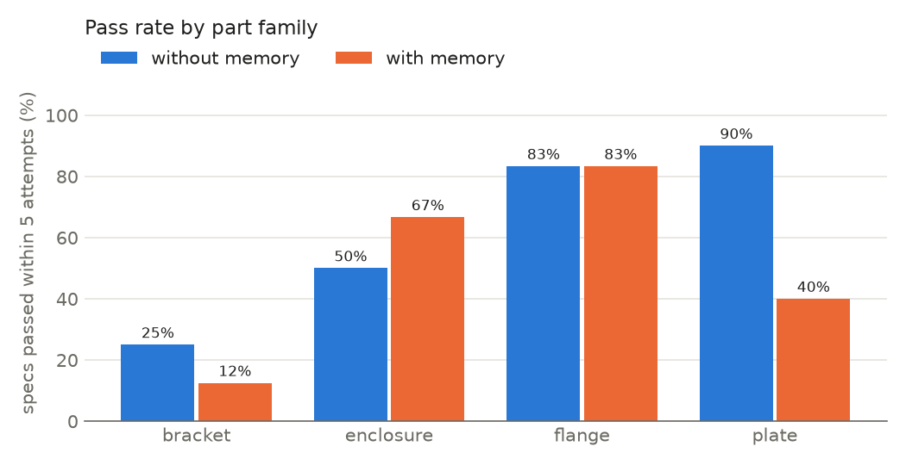

# cad-agent

An LLM agent that writes [CadQuery](https://github.com/CadQuery/cadquery) code
from a written part spec, a checker that measures the solid it builds, and a
memory of lessons from earlier mistakes. A 30-part benchmark measures whether the
memory helps.

## The problem: "it runs" is not "it's right"

Ask a language model for CAD code and it usually writes something that runs and
exports a solid. Whether that solid is the part you asked for is another
question: a hole 5 mm off, drilled from the wrong face or stopping halfway, an
enclosure open on the wrong side. None of these raise an error. You only find
them by measuring the part.

So this project treats the checker as the ground truth and builds it first. The
agent only gets told what the checker measured, with numbers:

```
FAIL
- hole_position: expected a 6.5 mm hole along Z at (45.0, 15.0); the nearest such hole is at (40.0, 15.0)
- hole_depth: the 6.6 mm hole along Z at (10.0, 10.0) is 4.0 mm deep, expected 8 mm
```

## How it works

```
            ┌──────────── spec text + up to 10 lessons ────────────┐
            ▼                                                      │
      ┌───────────┐  run_and_check(code)  ┌─────────────────────┐  │
      │   model   │ ────────────────────▶ │ sandbox process     │  │
      │ (tool     │                       │ python -I, 30 s,    │  │
      │  calling) │                       │ no API keys in env  │  │
      └───────────┘                       └─────────┬───────────┘  │
            ▲                                       │ part.step    │
            │        violations, with numbers       ▼              │
            └──────────────────────────────── ┌───────────┐        │
                     up to 5 attempts         │  checker  │        │
                                              └─────┬─────┘        │
                       needed fixes or failed?      │              │
                       ask for one general lesson ──┴─▶ memory ────┘
```

- **Model.** Groq's free `openai/gpt-oss-120b`, through any OpenAI-compatible
  API, so changing the model means changing one environment variable. The model
  gets one tool, `run_and_check`. Each call is one attempt.
- **Sandbox.** Generated code never runs inside the agent. It runs in its own
  `python -I` process in a temporary folder, with a 30 s limit and an
  environment stripped of API keys.
- **Checker** ([agent/checker.py](agent/checker.py)). It checks that the part is
  one valid solid, then its bounding box (±0.1 mm), volume (±1%), every hole
  (count, diameter, position, depth and direction, found from the cylindrical
  faces) and minimum wall thickness (by ray casting). If all of those pass, it
  compares the part with a hand-written reference part by boolean difference, to
  catch what the named checks cannot see.
- **Memory** ([agent/memory.py](agent/memory.py)). After a part that needed fixes
  or failed, the model writes one general lesson. A lesson that repeats any number
  from the spec is refused, so memory cannot carry answers, and so is one nearly
  the same as a lesson already kept. Up to 10 go into each prompt, same part
  family first. No vector database.

## The benchmark

30 specs in [specs/](specs), each tagged easy, medium or hard:

| Family | Count | What they test |
|---|---|---|
| Plates | 10 | outer size, hole patterns, chamfers, fillets, pockets, slots |
| L-brackets | 8 | two legs, holes on a specific face, fillets, gussets, slots |
| Flanges | 6 | bolt circles, bores, hubs, chamfered bores |
| Enclosures | 6 | shells, open faces, bosses with blind holes, rebates |

Each spec has the text the agent sees, the machine-checkable constraints, a
hand-written reference part, and broken copies of that part:

```yaml
id: bracket_01
text: >
  L-bracket made of 4 mm plate, 30 mm wide (Y). The horizontal leg lies on the
  XY plane and is 60 mm long in X. ...
constraints:
  bbox: [60, 30, 40]
  thickness_min: 4
  holes:
    - {d: 6.5, depth: 4, axis: z, at: [[15, 15], [45, 15]]}
broken:
  - {expect: wrong_face, replace: [...]}   # holes moved to the vertical leg
```

**How the checker was validated.** Before any model output was judged, all 30
reference parts pass the checker, and all 61 broken copies fail it with the
expected category: wrong face, wrong depth, a chamfer on the wrong side, an
enclosure open on the wrong face, and so on. The constraints are typed from the
text separately from the reference code, so a wrong reference is caught too.
That happened while building the benchmark: CadQuery's `.hole()` puts the next
feature back on the original workplane, so two references had holes that stopped
partway. The hole-depth check caught them, and plate_07 keeps that mistake as a
broken copy.

**Conditions.** A: no memory. B: memory builds up over the run, starting empty.
The same 30 specs in the same shuffled order for both conditions, temperature
1.0, seeded per run.

## Results

One run per condition with `openai/gpt-oss-120b` on Groq, 30 specs each. Every
number below comes from [results/openai_gpt-oss-120b/summary.md](results/openai_gpt-oss-120b/summary.md),
which `bench/analyze.py` builds from the committed logs.

| Metric | Without memory | With memory |
|---|---|---|
| Specs passed within 5 attempts | 63% (19/30) | 47% (14/30) |
| Passed on the first attempt | 13% | 7% |
| First attempt ran but was wrong | 33% | 27% |
| First attempt did not run | 53% | 67% |
| Mean attempts, specs that passed | 2.58 | 3.00 |
| Tokens per spec | 4,069 | 5,276 |

**Memory did not help; in this run it made things worse.** Paired by spec, 6
specs passed only without memory and 1 only with it. That gap is not
statistically significant on 30 specs (exact McNemar test, p = 0.125), so the
honest reading is "no measured benefit", not "memory hurts by 16 points".




## Failure analysis

**"It runs" is not "it's right".** Without memory, a third of first attempts
(33%) ran without an error and exported a solid that was wrong. Without the
checker, each of those would have looked like a success. The most common
violations across all failed attempts were the volume being off and the wrong
number of holes, followed by runtime errors and holes in the wrong place.

Typical mistakes the checker caught, all from code that ran:

- placing the second hole on `workplane(centerOption='CenterOfMass')`, which moves
  once the first hole is cut, so the hole lands 0.3 mm off;
- `faces('>Z').edges().chamfer(3)`, which chamfers every edge of the top face, not
  only the bore;
- bosses built next to an enclosure but never joined to it: five solids, not one.

**Why memory hurt: the lessons broke the tool calls.** The model sends its code
as JSON inside a tool call, and the provider rejects a call it cannot parse. With
0 to 3 lessons in the prompt, 5% of attempts were rejected, the same rate as
without memory. With 4 or more lessons, 21% to 32% were. Half of the first
attempts with memory (15 of 30) were rejected calls, against 3 of 30 without.
Plates suffered most (90% passed without memory, 40% with): every plate ran with
6 to 10 lessons in its prompt.

**The lessons themselves were weak.** Most are generic advice ("always verify
that all features are applied..."); 11 of 25 contain typographic characters such
as curly quotes and non-breaking hyphens; and one is plainly wrong: it says to stop
through holes at a pocket floor. Two kinds of lesson
were useful and specific: that `.hole()` needs a solid on the stack, and that
`Workplane.workplane()` has no `center` argument.

**A first version of memory was worse still.** It also asked for lessons after
rejected tool calls, so 4 of its first 13 lessons were "always include the code
argument in run_and_check". That run measured a bug, so it is
[archived with a note](results/openai_gpt-oss-120b/archive_B_memory_bug/NOTE.md)
and not counted above.

**Most frequent remaining failure:** a wrong hole count, in both conditions (4
of the 11 specs that failed without memory, 8 of the 16 with it).

## Limits and next ideas

- **One model, one run, 30 specs.** Error bars are wide; the 16-point gap above
  is not significant. More runs (`--runs 3`) would show the spread.
- **Next fix for memory:** fewer, shorter lessons in plain ASCII, kept apart
  from the code the model writes, and only lessons that name a specific CadQuery
  call. Then rerun condition B and check whether rejected tool calls drop back to
  the 5% seen without memory.
- **The sandbox limits time, not resources.** There is no memory or network cap,
  because Windows has no portable way to set one from Python. A container would.
- **Wall thickness is sampled**, 25 points per flat face. A wall that is thin only
  between sample points is missed.
- **Lessons are ranked by family and recency, not similarity.** That is enough
  for tens of lessons, not hundreds.
- **Next fix: a `query_faces` tool.** Many CAD mistakes are about which face a
  feature lands on. A tool that lists the faces of the current part and their
  directions, called before placing features, should cut `wrong_face` and
  `hole_position` failures. Re-running the hard specs would show whether it does.

## How to run it

Python 3.11 or newer.

```bash
pip install -e ".[dev]"
pytest
```

The tests need no API key. They run every reference and broken part through the
checker, and the agent loop and benchmark with a scripted model.

To run the benchmark, get a free API key from https://console.groq.com and set it:

```bash
export GROQ_API_KEY=...            # PowerShell: $env:GROQ_API_KEY = "..."
python -m bench.run_bench --runs 1
python -m bench.analyze results/openai_gpt-oss-120b
```

One condition-run of 30 specs uses roughly a day of Groq's free token budget. If
the limit is reached, the run stops with a message; run the same command again
later and it carries on from where it stopped.

Other models: set `CAD_AGENT_BASE_URL`, `CAD_AGENT_MODEL` and `CAD_AGENT_API_KEY`
for any OpenAI-compatible API (see [agent/llm.py](agent/llm.py)).

How the code is organised: [ARCHITECTURE.md](ARCHITECTURE.md).

## License

MIT
