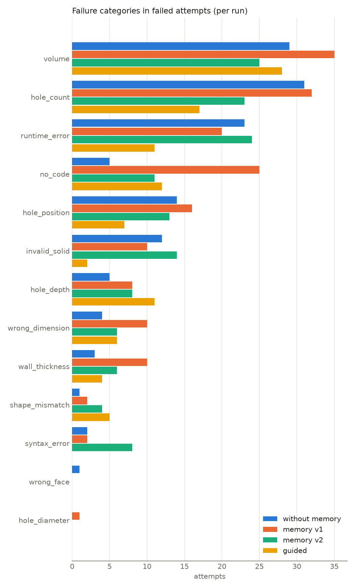

# cad-agent

An LLM agent that writes [CadQuery](https://github.com/CadQuery/cadquery) code
from a written part spec, and a checker that measures the solid it builds. A
30-part benchmark compares four ways of helping the model: none, two versions of
a memory of lessons it writes itself, and a hand-written guide with more precise
feedback. The guide raised the pass rate from 63% to 77%; the learned memories
lowered it to 47%.

## The problem: "it runs" is not "it's right"

Ask a language model for CAD code and it usually writes something that runs and
exports a solid. Whether that solid is the part you asked for is another
question: a hole 5 mm off, drilled from the wrong face or stopping halfway, an
enclosure open on the wrong side. None of these raise an error. You only find
them by measuring the part.

So this project treats the checker as the ground truth and builds it first. The
agent only gets told what the checker measured, with numbers:

```
FAIL
- hole_position: expected a 6.5 mm hole along Z at (45.0, 15.0); the nearest such hole is at (40.0, 15.0)
- hole_depth: the 6.6 mm hole along Z at (10.0, 10.0) is 4.0 mm deep, expected 8 mm
```

## How it works

```
            ┌────────────── spec text + lessons ───────────────────┐
            ▼                                                      │
      ┌───────────┐  run_and_check(code)  ┌─────────────────────┐  │
      │   model   │ ────────────────────▶ │ sandbox process     │  │
      │ (tool     │                       │ python -I, 30 s,    │  │
      │  calling) │                       │ no API keys in env  │  │
      └───────────┘                       └─────────┬───────────┘  │
            ▲                                       │ part.step    │
            │        violations, with numbers       ▼              │
            └──────────────────────────────── ┌───────────┐        │
                     up to 5 attempts         │  checker  │        │
                                              └─────┬─────┘        │
                       needed fixes or failed?      │              │
                       ask for one general lesson ──┴─▶ memory ────┘
```

- **Model.** Groq's free `openai/gpt-oss-120b`, through any OpenAI-compatible
  API, so changing the model means changing one environment variable. The model
  gets one tool, `run_and_check`. Each call is one attempt.
- **Sandbox.** Generated code never runs inside the agent. It runs in its own
  `python -I` process in a temporary folder, with a 30 s limit and an
  environment stripped of API keys.
- **Checker** ([agent/checker.py](agent/checker.py)). It checks that the part is
  one valid solid, then its bounding box (±0.1 mm), volume (±1%), every hole
  (count, diameter, position, depth and direction, found from the cylindrical
  faces) and minimum wall thickness (by ray casting). If all of those pass, it
  compares the part with a hand-written reference part by boolean difference, to
  catch what the named checks cannot see.
- **Memory** ([agent/memory.py](agent/memory.py)). After a part that needed fixes
  or failed, the model writes one general lesson. A lesson that repeats any number
  from the spec is refused, so memory cannot carry answers, and so is one nearly
  the same as a lesson already kept. Same part family first, then newest. No
  vector database. There are two versions: v1 puts up to 10 lessons in a
  prompt; v2, built from what v1's run showed, puts at most 3, keeps them to 30
  words of plain ASCII, and refuses any that do not name a CadQuery call.

## The benchmark

30 specs in [specs/](specs), each tagged easy, medium or hard:

| Family | Count | What they test |
|---|---|---|
| Plates | 10 | outer size, hole patterns, chamfers, fillets, pockets, slots |
| L-brackets | 8 | two legs, holes on a specific face, fillets, gussets, slots |
| Flanges | 6 | bolt circles, bores, hubs, chamfered bores |
| Enclosures | 6 | shells, open faces, bosses with blind holes, rebates |

Each spec has the text the agent sees, the machine-checkable constraints, a
hand-written reference part, and broken copies of that part:

```yaml
id: bracket_01
text: >
  L-bracket made of 4 mm plate, 30 mm wide (Y). The horizontal leg lies on the
  XY plane and is 60 mm long in X. ...
constraints:
  bbox: [60, 30, 40]
  thickness_min: 4
  holes:
    - {d: 6.5, depth: 4, axis: z, at: [[15, 15], [45, 15]]}
broken:
  - {expect: wrong_face, replace: [...]}   # holes moved to the vertical leg
```

**How the checker was validated.** Before any model output was judged, all 30
reference parts pass the checker, and all 61 broken copies fail it with the
expected category: wrong face, wrong depth, a chamfer on the wrong side, an
enclosure open on the wrong face, and so on. The constraints are typed from the
text separately from the reference code, so a wrong reference is caught too.
That happened while building the benchmark: CadQuery's `.hole()` puts the next
feature back on the original workplane, so two references had holes that stopped
partway. The hole-depth check caught them, and plate_07 keeps that mistake as a
broken copy.

**Conditions.** A: no memory. B: memory v1. C: memory v2. In B and C the memory
starts empty and builds up over the run. D (guided) has no memory. Instead it
adds a hand-written CadQuery guide whose examples are tested, hints in the
checker's feedback, and a short history of earlier attempts in each retry. All three see the same 30 specs in the
same shuffled order, at temperature 1.0, seeded per run.

## Results

One run per condition with `openai/gpt-oss-120b` on Groq, 30 specs each. Every
number below comes from [results/openai_gpt-oss-120b/summary.md](results/openai_gpt-oss-120b/summary.md),
which `bench/analyze.py` builds from the committed logs.

| Metric | A: no memory | B: memory v1 | C: memory v2 | D: guided |
|---|---|---|---|---|
| Specs passed within 5 attempts | 63% (19/30) | 47% (14/30) | 47% (14/30) | **77% (23/30)** |
| Passed on the first attempt | 13% | 7% | 17% | **37%** |
| First attempt ran but was wrong | 33% | 27% | 27% | 30% |
| First attempt did not run | 53% | 67% | 57% | 33% |
| Mean attempts, specs that passed | 2.58 | 3.00 | 2.21 | 2.13 |
| Attempts rejected as malformed tool calls | 5% | 20% | 10% | 14% |
| Tokens per spec | 4,069 | 5,276 | 4,828 | 4,472 |

**Neither version of memory helped.** Paired by spec against the run without
memory, v1 has 6 specs that passed only without memory and 1 only with it
(exact McNemar test, p = 0.125); v2 has 7 and 2 (p = 0.180). Neither gap is
statistically significant on 30 specs, so the honest reading is "no measured
benefit", not "memory hurts by 16 points". v2's better first-attempt rate (5
specs against 4) is one spec, which is noise.

**The guided condition did best, but one run cannot prove it.** D passed 23 of
30 specs and nearly three times as many on the first attempt (11 against 4).
Paired by spec, 5 specs passed only with D and 1 only without help (p = 0.219):
promising, not yet significant. Three runs of A and D would settle it.




## Failure analysis

**"It runs" is not "it's right".** Without memory, a third of first attempts
(33%) ran without an error and exported a solid that was wrong. Without the
checker, each of those would have looked like a success. The most common
violations across all failed attempts were the volume being off and the wrong
number of holes, followed by runtime errors and holes in the wrong place.

Typical mistakes the checker caught, all from code that ran:

- placing the second hole on `workplane(centerOption='CenterOfMass')`, which moves
  once the first hole is cut, so the hole lands 0.3 mm off;
- `faces('>Z').edges().chamfer(3)`, which chamfers every edge of the top face, not
  only the bore;
- bosses built next to an enclosure but never joined to it: five solids, not one.

**Memory v1: the lessons broke the tool calls.** The model sends its code as
JSON inside a tool call, and the provider rejects a call it cannot parse. With 0
to 3 lessons in the prompt, 5% of attempts were rejected, the same rate as
without memory. With 4 or more lessons, 21% to 32% were. Half of v1's first
attempts (15 of 30) were rejected calls, against 3 of 30 without memory. Plates
suffered most (90% passed without memory, 40% with v1): every plate ran with 6
to 10 lessons in its prompt. The lessons were also weak: most were generic advice
("always verify that all features are applied..."), 11 of 25 contained curly
quotes or non-breaking hyphens, and one was plainly wrong.

**Memory v2 fixed the tool calls, but not the pass rate.** v2 was built to fix
exactly that: at most 3 lessons, plain ASCII, and each must name a CadQuery call.
Rejected first attempts fell back to 4 of 30 (3 without memory), and plates
recovered to 80%. Yet the pass rate stayed at 47%, because flanges (83% to 50%)
and enclosures (50% to 17%) fell. So the broken tool calls explain much of what
went wrong with v1, but not all of it: once they are fixed, the lessons still do
not help.

**Naming a CadQuery call does not make a lesson correct.** The new filter let 22
of 24 lessons through. Some are useful and specific: `.workplane()` has no
`center` or `centerPoint` argument; use Python's `math`, not `cq.math`;
`.cutBlind()` needs a depth. But at least three are wrong, and the model has no
way to tell:

- "the default half-depth creates shallow holes": `.hole()` cuts all the way
  through by default;
- "CadQuery's parser cannot handle grouped expressions" in selectors: it can;
- an example selector, `"<X or Y>"`, that is not valid syntax.

Two more are about Python indentation, not CAD. The model writes a lesson from
its own mistake, often before it knows the fix, and nothing checks the lesson
against CadQuery. A lesson is kept only if it looks right, not because it is.

**A first version of memory was worse still.** It also asked for lessons after
rejected tool calls, so 4 of its first 13 lessons were "always include the code
argument in run_and_check". That run measured a bug, so it is
[archived with a note](results/openai_gpt-oss-120b/archive_B_memory_bug/NOTE.md)
and not counted above.

**Most frequent remaining failure:** a wrong hole count without memory, with v1
and in D (2 of D's 7 failures) (4 of the 11 specs that failed without memory, 8 of the 16 with v1). With v2
it is code that does not run or builds an invalid solid (8 of 16 failed specs,
against 4 of 11 without memory), which fits lessons that send the model towards
wrong API use.

**The guided condition fixed the failures the logs pointed at.** The specs that
passed only with D are the ones that kept repeating one mistake without help:

- bracket_01, an easy bracket whose holes landed 0.3 mm off five times without
  help, passed on the first attempt: the guide says to build from the origin
  and place holes with `.workplane(origin=(0, 0, 0))`;
- enclosure_03, "expected one solid, found 5" five times without help, passed on
  the second attempt, after the hint listed where the five solids were;
- enclosure_04, a hole along Y missing four times without help, passed on the
  second attempt.

The passing code uses the advice it was given: bracket_01 places its holes with
`.workplane(origin=(0, 0, 0))`, enclosure_04 cuts its hole with
`cq.Solid.makeCylinder` as the guide's example does, and enclosure_03 joins its
parts with `.union()`.

Runs that crashed fell from 24% of attempts to 13%. Brackets rose from 25% to
62%, enclosures from 50% to 83%, and every easy spec passed. Hard specs did not
move (40%), and one flange that passed without help failed with it.

The difference from memory is where the knowledge comes from. The learned
lessons were written by the model about its own mistake, often wrong, and never
checked. The guide is written once, about the mistakes the logs showed most, and
every example in it is built and measured by the tests.

**The cost: more rejected tool calls.** 14% of D's attempts were tool calls the
provider rejected, against 5% without help. The guide adds about 500 tokens to
the prompt; as with v1's lessons, a longer prompt went with more rejected calls.
A shorter guide may keep the gain and lose the cost.

**A note on the v2 run.** The run resumes between specs, not within one. While
the daily token limit was nearly used up, bracket_03 was started 45 times and cut
off each time before it finished. Only the finished attempt is counted: the
analysis ignores attempts of unfinished specs. No lesson is written until a spec
finishes, so the restarts did not change the memory.

## Limits and next ideas

- **One model, one run, 30 specs.** Error bars are wide, and none of the gaps
  above is significant. The next step is two more runs each of A and D
  (`--runs 3 --conditions AD`), about four days of the free budget.
- **Hard specs are where the room is.** D still fails 6 of 10 hard specs. Most
  are brackets and enclosures with several features on different faces.
- **Next fix for memory: check a lesson before keeping it.** Shape rules (length,
  ASCII, naming a call) fixed the tool calls but let wrong lessons through. A
  lesson should be kept only if it changes behaviour, for example only if the
  spec it came from passes when solved again with the lesson in the prompt. That
  costs a solve per lesson, so it waits for a larger token budget.
- **The sandbox limits time, not resources.** There is no memory or network cap,
  because Windows has no portable way to set one from Python. A container would.
- **Wall thickness is sampled**, 25 points per flat face. A wall that is thin only
  between sample points is missed.
- **Lessons are ranked by family and recency, not similarity.** That is enough
  for tens of lessons, not hundreds.
- **Next fix: a `query_faces` tool.** Many CAD mistakes are about which face a
  feature lands on. A tool that lists the faces of the current part and their
  directions, called before placing features, should cut `wrong_face` and
  `hole_position` failures. Re-running the hard specs would show whether it does.

## How to run it

Python 3.11 or newer.

```bash
pip install -e ".[dev]"
pytest
```

The tests need no API key. They run every reference and broken part through the
checker, and the agent loop and benchmark with a scripted model.

To run the benchmark, get a free API key from https://console.groq.com and set it:

```bash
export GROQ_API_KEY=...            # PowerShell: $env:GROQ_API_KEY = "..."
python -m bench.run_bench --runs 1
python -m bench.analyze results/openai_gpt-oss-120b
```

One condition-run of 30 specs uses roughly a day of Groq's free token budget. If
the limit is reached, the run stops with a message; run the same command again
later and it carries on from the spec where it stopped. The limit is a rolling
24 hours, so wait several hours, not minutes: a spec started with too few tokens
left is cut off and starts again from its first attempt.

Other models: set `CAD_AGENT_BASE_URL`, `CAD_AGENT_MODEL` and `CAD_AGENT_API_KEY`
for any OpenAI-compatible API (see [agent/llm.py](agent/llm.py)).

How the code is organised: [ARCHITECTURE.md](ARCHITECTURE.md).

## License

MIT
